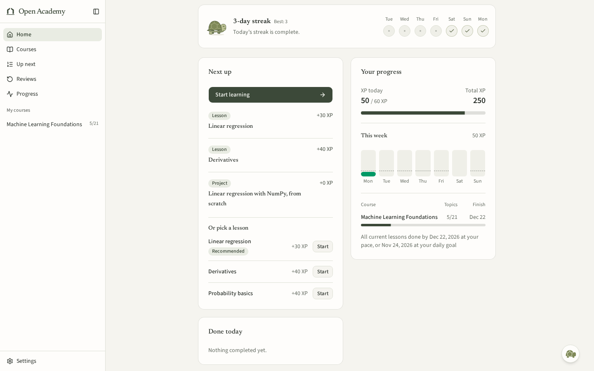
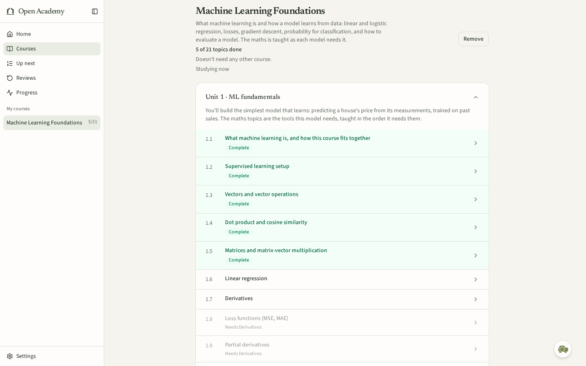
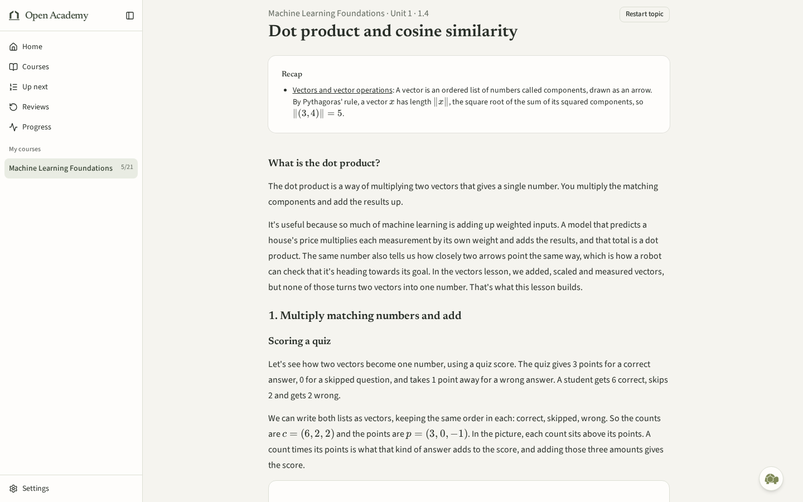

# Open Academy

Open Academy is a learning app you host yourself. It's modelled on [Math Academy](https://www.mathacademy.com): short lessons that each end in a quiz, spaced reviews so you don't forget what you learned, and a placement check so you can skip what you already know. It keeps track of which topics you've passed and how well you still remember them, and uses that to plan each day.

It comes with courses on maths for machine learning, AI and robotics. You can also write a course on any subject, either from scratch or from your own notes and textbooks. An AI coding agent can do most of the writing.

There's a demo at [open-academy-demo.vercel.app](https://open-academy-demo.vercel.app). You don't need an account: each browser gets its own learner, and its progress is deleted after 24 hours. The tutor is turned off in the demo.



## How it works

A subject is a set of topics, and each topic lists the topics you need first. A course is a path through those topics, grouped into units.

The first time you start a course, you can take a short placement check or start from the beginning. Topics you place out of count as done.

Each lesson is a few short steps. Every step has a worked example and a question or two, and the lesson ends with a quiz. Pass the quiz and the topic is done. After that it comes back for review on a spaced schedule ([FSRS](https://github.com/open-spaced-repetition/ts-fsrs)), and if you fail a review the lesson opens up again.

Every day, Home picks your reviews and next lessons to fit the time you said you have. Reviews come first, then up to two new topics. You can also open any unlocked topic yourself whenever you like.

If you add an OpenAI API key, there's a tutor next to every lesson. It can see the question you're on and the answer key, so it can explain things and give hints. It doesn't do the marking. Answers are graded by code.



## The included courses

```text
Mathematics   Mathematics for Machine Learning
AI            ML Foundations → Deep Learning → Transformers and LLMs → LLM Inference → Reinforcement Learning
Robotics      Classical Robotics → Robot Learning
```

Most maths and AI topics have lessons. A few are still being written, and the two robotics courses are planned but have no lessons yet. Topics without a lesson show "Lessons coming soon".

Courses are never locked as a whole. A topic opens as soon as the topics it needs are done, even when they belong to a different course. Each course page lists the courses it builds on and how much of each you've finished.

Courses within a subject are taught in order. When you have more than one subject, Home spreads new topics across them so that one subject doesn't take all your time. The Focus buttons on Home let you stick to a single subject.

Up next shows the topics you'll learn, in order, with rough dates. Finish dates are estimates based on how much XP you've been earning lately.

## Run it locally

You need Node 24, pnpm and Docker.

```sh
git clone https://github.com/Jonathanvwersch/open-academy.git
cd open-academy
pnpm bootstrap
pnpm dev
```

Then open http://localhost:5173. The included courses load by default. To turn on the tutor, set `OPENAI_API_KEY` in your environment.



## Make your own course

A course pack is a folder of YAML files holding topics, lessons, questions and courses. The `academy` CLI creates a pack and checks it for mistakes.

```sh
pnpm academy init ~/courses/organic-chemistry --title "Organic chemistry"
pnpm academy dev ~/courses/organic-chemistry
```

To write it with an agent, open the pack folder in Claude Code, Codex or a similar tool and say what you want, for example: "Plan a first-year organic chemistry course and write the first unit." Each pack comes with an `AGENTS.md` and skills for planning a course, writing lessons and working from your sources. The agent runs `academy check` until everything passes.

If you have lecture notes or a textbook, add them first. The lessons are then written from them, with citations.

```sh
pnpm academy sources add ~/Downloads/week-3-notes.pdf --pack ~/courses/organic-chemistry
```

Your source files stay on your machine and aren't committed. [Writing your first course](docs/first-course.md) walks through it step by step.

## Host it

- **Vercel and Neon:** [](https://vercel.com/new/clone?repository-url=https%3A%2F%2Fgithub.com%2FJonathanvwersch%2Fopen-academy&env=DATABASE_URL,ACADEMY_PASSWORD&envDescription=A%20Postgres%20URL%20%28Neon%20works%29%20and%20a%20sign-in%20password%20of%20at%20least%2012%20characters&envLink=https%3A%2F%2Fgithub.com%2FJonathanvwersch%2Fopen-academy%2Fblob%2Fmain%2Fdocs%2Fself-hosting.md)
- **Your own server:** `docker compose -f deploy/docker-compose.yml up -d`

[Self-hosting](docs/self-hosting.md) covers both. Each instance is for one learner and is protected by a password you choose (`ACADEMY_PASSWORD`). There's also a [public demo mode](docs/self-hosting.md#public-demo) like the one above, where each visitor gets temporary progress.

## Project layout

| Path                                    | What's there                                                     |
| --------------------------------------- | ---------------------------------------------------------------- |
| `apps/web`                              | The React app                                                    |
| `apps/api`                              | The API: loading content, grading, mastery, scheduling, tutor    |
| `packages/cli`                          | The `academy` CLI                                                |
| `packages/contracts`, `packages/shared` | Types and helpers used by both the web app and the API           |
| `content`                               | The included course pack (maths, AI and robotics)                |
| `labs`                                  | Starter code and tests for the programming projects in that pack |

[Architecture](docs/architecture.md) and [Content format](docs/CONTENT_FORMAT.md) go into more detail.

## Contributing

See [CONTRIBUTING.md](CONTRIBUTING.md).

## License

[MIT](LICENSE)
